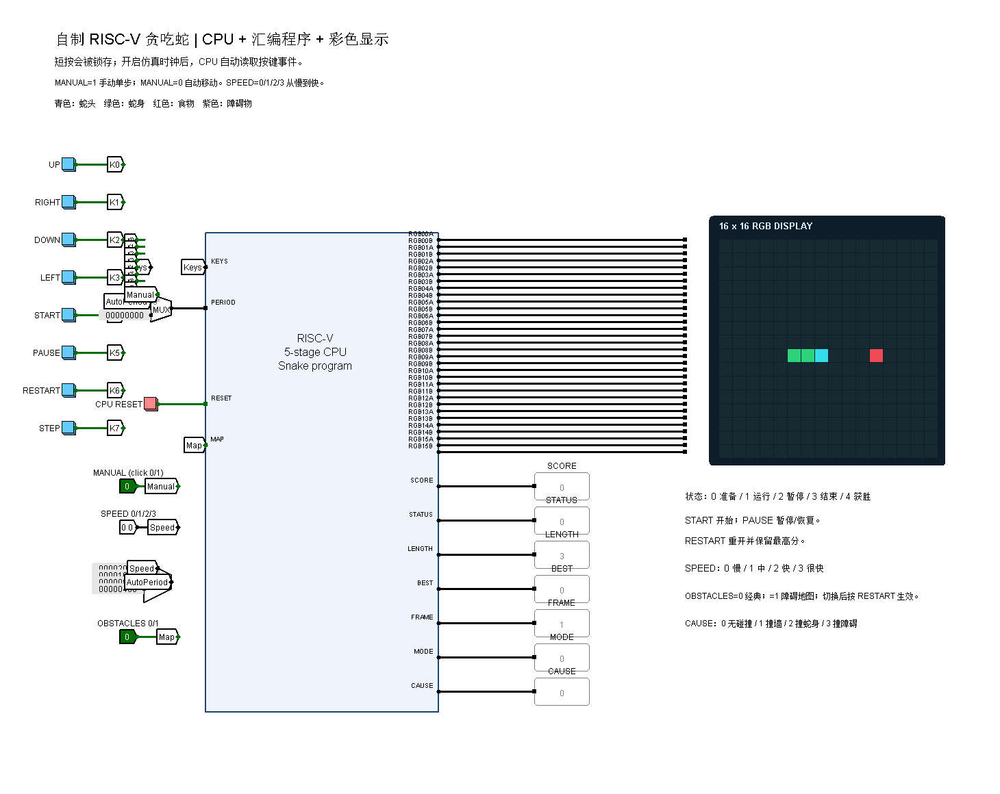
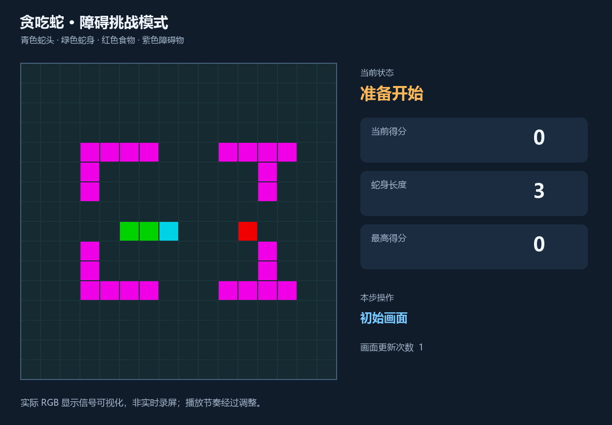

# 自制 RISC-V CPU 贪吃蛇：障碍挑战版

本项目基于你提供的 `cpu21-riscv (1).circ` 中的“◇重定向流水线”制作。
游戏的移动、增长、碰撞、食物生成、计分、暂停和重开，由原 CPU 执行 RISC-V 汇编程序完成。
新增硬件负责按键事件锁存、计时、内存映射寄存器、整帧提交及 16×16 RGB 显示。

本版改进：短按锁存、按住不连发、四档速度、真正的手动模式、整帧刷新、青色蛇头/绿色蛇身/红色食物。
新增可选障碍模式：24 格紫色固定障碍、撞障碍结束、食物避障、按可用格数判定获胜；经典模式仍然保留。

这是已经通过程序测试和实际 Logisim 引擎检查的基础版本；尚未开展开发板适配或长时间人工试玩。





## 直接打开

1. 解压整个文件夹，保留 `snake.circ`、`cs3410.jar`、`riscv-probe.jar`、`snake-display.jar` 的相对位置。
2. 双击 `启动贪吃蛇.cmd`，或使用 Logisim 2.15 打开 `snake.circ`。主电路为 `Snake`。
3. 在“仿真”菜单中开启时钟，并选择较高的时钟频率，例如 1.024 kHz 或 4.096 kHz（以软件中可选项为准）。
4. 等待初始画面出现：三格蛇身、一个食物，STATUS=0、LENGTH=3、FRAME=1。
5. 使用戳工具点击 START，等待 STATUS 变为 1。短按会锁存，不再需要一直按住等待 CPU 轮询。

首次建议把 `MANUAL` 输入引脚从 0 点击为 1，再按 START，使用 STEP 控制每次前进一步。
这样可以先了解按键和画面，不会因操作不熟悉而自动撞墙。
MANUAL=0 时按 SPEED 的设置自动移动；MANUAL=1 时完全关闭自动移动。
从手动切回自动时，如果已有等待时间超过所选间隔，可能立即移动一次。
同一按键在 CPU 消费事件前的多次点击会合并为一次；这是单事件锁存，而非按键队列。

## 操作

| 面板项目 | 含义 |
|---|---|
| UP / RIGHT / DOWN / LEFT | 改变移动方向，禁止直接反向 |
| START | 从准备状态开始游戏 |
| PAUSE | 暂停或恢复，按下后要松开才能再次切换 |
| RESTART | 重开一局并返回准备状态，保留本次运行中的最高分 |
| STEP | 运行状态下前进一步；按下后松开，才能再次触发 |
| CPU RESET | 复位整个 CPU 和外设，也会清除最高分 |
| MANUAL=0 | 根据 SPEED 设置自动移动 |
| MANUAL=1 | 完全关闭自动移动，只响应方向和 STEP |
| SPEED=0/1/2/3 | 等待间隔为 8192/4096/2048/1024 个 CPU 周期，从慢到快 |
| OBSTACLES=0/1 | 选择经典/障碍地图，按 RESTART 或 CPU RESET 后生效 |
| MODE | 当前这一局实际采用的地图：0 经典、1 障碍 |
| CAUSE | 结束原因：0 无碰撞、1 撞边界、2 撞蛇身、3 撞障碍 |
| SCORE / BEST | 当前得分 / 当前运行会话最高分，十进制显示 |
| LENGTH | 当前蛇长，初始为 3 |
| FRAME | 已完成的画面更新次数，便于确认程序在运行 |

STATUS：0=准备；1=运行；2=暂停；3=游戏结束；4=填满棋盘获胜。
SPEED 是两位输入引脚，二进制 00/01/10/11 分别对应 0/1/2/3；用戳工具点击对应位设置。

地图左上角为 (0,0)，右下角为 (15,15)。初始蛇身为 (5,8)、(6,8)、(7,8)，朝右；
第一个食物在 (11,8)。从开始状态连续前进四格可以演示吃食物、增长和加分。
青色表示蛇头，绿色表示蛇身，红色表示食物。重新显示时先更新暂存区，最后一次性提交，避免清空重画的中间状态被看到。
紫色表示障碍物，不能穿越。切换 OBSTACLES 输入不会在正在玩的这一局突然出现或移除障碍；请按 RESTART 应用设置。
每次移动、开始或恢复后，完成画面提交，再重新开始等待间隔，避免慢帧导致连续追赶移动。

## 障碍模式

1. 将 OBSTACLES 设为 1。
2. 点击 RESTART，确认 MODE=1，画面出现紫色障碍。
3. 点击 START 开始。初始蛇身和第一个食物仍在第 8 行的安全通道中。
4. 撞障碍后 STATUS=3、CAUSE=3；重新开始可再玩一局。

恢复经典模式：OBSTACLES=0，再按 RESTART。

固定地图共 24 格障碍，剩余 232 格均连通，没有孤立的不可达空地。经典模式填满 256 格获胜，障碍模式填满 232 格获胜。
食物生成会同时排除障碍和蛇身，最后一格填满后直接获胜，不再搜索食物。最高分在当前运行会话的两种模式之间共用。

## 工程结构

| 文件 | 内容 |
|---|---|
| `snake.circ` | 完整演示工程，已经内置游戏机器码 |
| `software/snake.s` | 游戏汇编源码 |
| `snake-display.jar` | 只负责绘制输入 RGB 像素的显示外设，不执行游戏逻辑 |
| `display/*.java` | 彩色显示外设的完整 Java 源码 |
| `build/snake.hex` | 可加载进指令 ROM 的 Logisim 原始十六进制格式 |
| `build/snake.lst` | 指令地址、机器码和源码对照 |
| `build/panel.png` | 用实际 Logisim 引擎渲染并检查过的初始面板 |
| `cpu_reference.circ` | 原始工程的工作副本，旁边已有所需组件库 |
| `original/cpu21-riscv.circ` | 原始文件的逐字节备份 |
| `tools/rv32.py` | 本项目所用指令子集的严格汇编器和指令级执行工具 |
| `tools/build_circuit.py` | 从原始电路重新生成游戏工程 |
| `tools/check_logisim.py` | 在实际重定向流水线电路上执行集成检查 |
| `tools/check_ux.py` | 通过面板验证短按、长按、忙碌时输入、速度、暂停和重开 |
| `tools/game_map.py` | 固定地图的预期坐标，用于验证地图、连通性和演示 |
| `tools/build_display.py` | 从 Java 源码编译显示外设 |
| `tools/make_demo.py` | 实际电路演示动图及原生界面取帧 |
| `tools/render_panel.py` | 检查面板接线并渲染实际电路 |
| `tests/test_game.py` | 游戏规则和边界情况测试 |

原有 CPU 各版本都保留在新工程里。新增 `SnakeCore` 是独立副本：
原流水线、寄存器堆和控制器复用；原数据 RAM 的读路径加入 I/O 选择器，写使能加入 I/O 地址屏蔽。
外部监测引脚在该副本中改为探针，原中断输入固定为 0；第一版游戏采用轮询，不依赖中断。

原文件位于 `D:/存储信息/cpu21-riscv (1).circ`，没有被本项目覆盖或修改。
随项目附带的 Logisim、cs3410.jar、riscv-probe.jar 取自本机已有课程资料包。
snake-display.jar 由本项目 display/ 下的源码编译生成。它是无状态的输出组件：
只读取电路中 32 路 24 位 RGB 数据并画出方格，不保存蛇身、不生成食物、不处理输入，也不计算分数。
颜色编码逻辑及显示寄存器均在 SnakeCore 的 Logisim 电路中，可以展开查看。

## CPU 与外设接口

CPU 使用字节地址，LW/SW 地址应四字节对齐。原 RAM 地址取地址的 [11:2]。
将 `0x700..0x7ff` 保留为 I/O 页，对该页写入不再写原数据 RAM；未定义的 I/O 读地址返回 0。

| 字节地址 | 方向 | 含义 |
|---|---|---|
| 0x700 | 读 | 已锁存的按键事件：UP=1、RIGHT=2、DOWN=4、LEFT=8、START=16、PAUSE=32、RESTART=64、STEP=128 |
| 0x704 | 读 | 32 位 CPU 时钟周期计数器，支持自然回绕 |
| 0x708 | 读 | 移动间隔；0 表示手动模式 |
| 0x70c | 写 | 对应位写 1，清除已消费按键事件；写 0 不影响对应位 |
| 0x710 | 读 | 请求的地图模式，复位/重开时采样：0 经典、1 障碍 |
| 0x740+4×y，y=0..15 | 读写 | 第 y 行显示数据，低 16 位有效；第 x 列对应 bit(15-x) |
| 0x780 | 读写 | 当前得分 |
| 0x784 | 读写 | 游戏状态 |
| 0x788 | 读写 | 蛇头坐标，编码 y×16+x |
| 0x78c | 读写 | 食物坐标，同上；0xffffffff 表示无食物 |
| 0x790 | 读写 | 蛇长 |
| 0x794 | 读写 | 最高分 |
| 0x798 | 读写 | 完成画面更新次数；写入时同步提交所有显示行、坐标、分数和状态 |
| 0x79c | 读写 | 当前局生效的地图模式 |
| 0x7a0+4×y，y=0..15 | 读写 | 障碍显示行，低 16 位有效，位序与普通显示行相同 |
| 0x7e0 | 读写 | 碰撞原因：0 无、1 边界、2 蛇身、3 障碍 |

每个按键由上升沿触发的 D 触发器保存一次待处理事件。即使按下、松开都发生在两次 CPU 时钟之间，
CPU 下次读取仍能看到该事件；按住只生成一次。软件读取后立即对 0x70c 写回已读取位，进行确认。
CPU 复位清除待处理事件。FPGA 迁移时仍需按真实按键与时钟域补充消抖和同步设计。

数据 RAM：0x000..0x03b 保存游戏状态（0x30=地图模式、0x34=可用格数、0x38=碰撞原因）；
0x100..0x4ff 为 256 项循环队列；0x500..0x53f 为显示掩码表；0x540..0x57f 为障碍位图；
栈顶为 0x680，向下增长。
汇编中使用私有调用约定：子程序保证 ra、sp、s11 的使用规则，其余寄存器可以作为工作寄存器。
若以后接入 C 编译器，需要改成标准 ABI。

蛇身用循环队列保存，移动时更新队头/队尾。非增长移动允许进入本轮即将离开的尾格。
食物生成使用模 256 的线性同余序列 (5×seed+1) mod 256，并跳过蛇身占用格；这是伪随机序列。
同一复位状态会重复相同序列。满棋盘直接进入获胜状态，避免找不到空格而死循环。

## 已完成的验证

- 21 项指令级测试：原有游戏规则、输入和计时检查，以及障碍地图/出生安全/连通性、四方向撞障碍、可穿行通道、全部 256 个 RNG 种子的食物避障、模式切换、障碍模式最后空格与获胜。
- 实际 Logisim 引擎中的原重定向流水线：初始化、开始、单步移动、暂停、恢复、吃食物、增长、计分、重开。
- 实际电路集成检查还验证：短按在 CPU 无时钟期间被保留，显示在 FRAME 提交前保持上一帧，长按不连发。
- 面板操作检查验证：四档速度与手动模式、CPU 忙碌期间的再次点击、吃食物后的正确颜色、暂停时 STEP 不移动。
- 障碍模式实际电路检查：24 个紫色格与地图一致；CPU 拒绝连续两个落在障碍上的食物候选；碰撞后保留原蛇头位置并报告 CAUSE=3；重开后可切回经典模式。
- 顶层面板：八个按钮位映射、CPU 复位、256 个 RGB 像素、得分/状态/长度/最高分/帧数接线，确认无未知值或错误值。
- 画面方向：按地图坐标验证初始亮点在 (5,8)、(6,8)、(7,8)、(11,8)。

当前程序为 345 条指令，使用 1380/4096 字节的指令 ROM。
以上验证不等同于 FPGA 验收，也不替代后续人工长时间试玩。

## 修改与重新生成

只运行程序测试不需要 Java 或第三方 Python 包：

```powershell
python tests/test_game.py
```

编译机器码：

```powershell
python tools/rv32.py
```

重新生成电路、运行 Logisim 引擎测试需要 Windows、Python 3.12、64 位 Java 8，以及开发依赖：

```powershell
python -m pip install --target tools/_vendor -r requirements-dev.txt
python tools/build_display.py
python tools/build_circuit.py
python tools/check_logisim.py
python tools/check_ux.py
python tools/render_panel.py
python tools/make_demo.py
python tools/make_demo.py --obstacles
```

默认 Java 路径为 D:/java，可通过环境变量 `SNAKE_JAVA_HOME` 指定其他 Java 8 安装目录。
工具为处理 Java 8 的中文路径兼容问题，会把引擎和开发依赖复制到系统临时目录 snake-cpu-tools。
运行游戏本身不需要 Python 或这些开发依赖。
重新编译显示外设时，脚本会从 Maven Central 下载固定版本的 Eclipse ECJ 4.6.1 编译器到本地开发依赖目录。
已经附带编译后的 snake-display.jar，正常运行无需下载编译器。

## 后续完善顺序

1. 在队友电脑上打开，并开展长时间人工试玩，按实际机器性能选择速度。
2. 整理系统框图、模块说明、测试记录和团队分工，准备互评演示。
3. 增加 CPU 周期、气泡等运行观察，设计固定输入的性能对比。
4. 领取开发板后，按板卡和外设条件评估硬件迁移。

先保留这个能验证基本功能的版本，再逐项增加功能。
